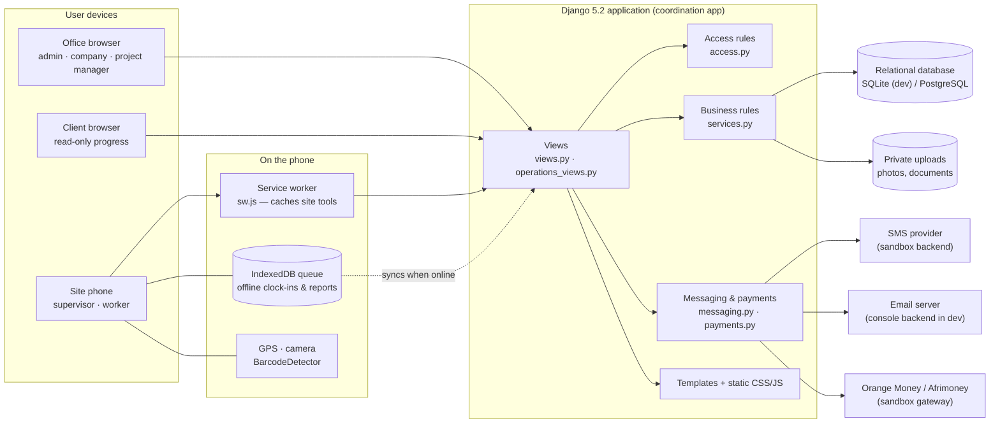
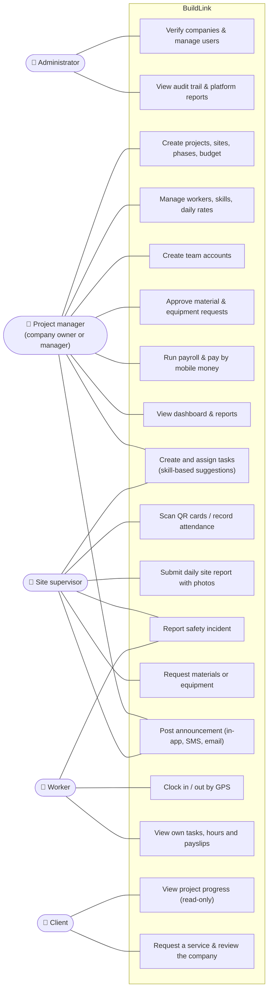
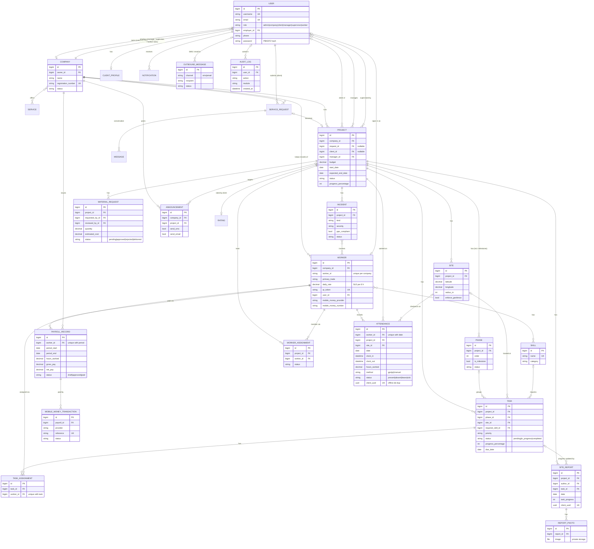
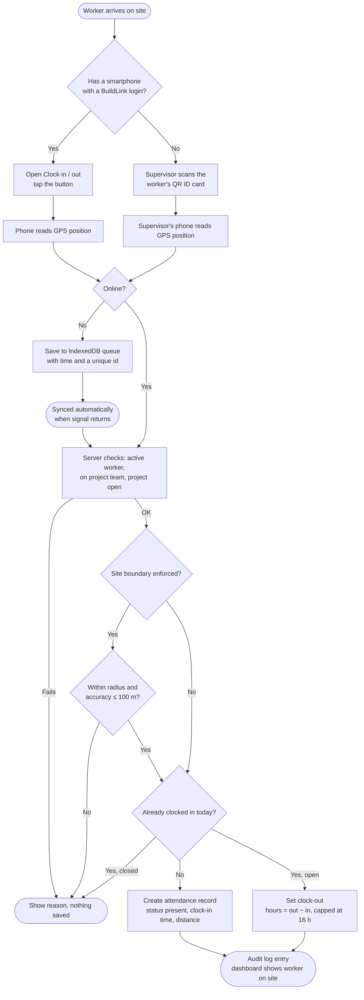
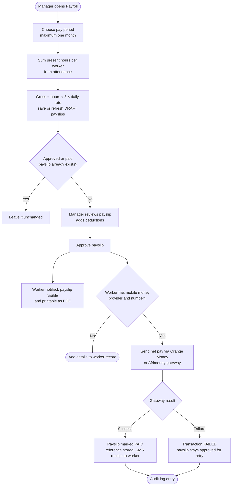
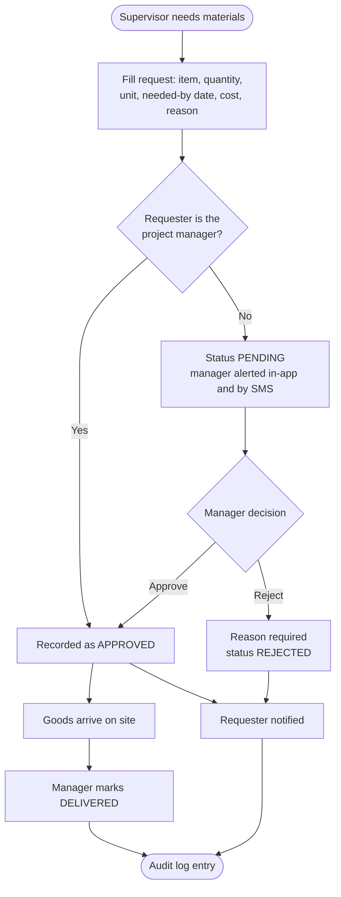
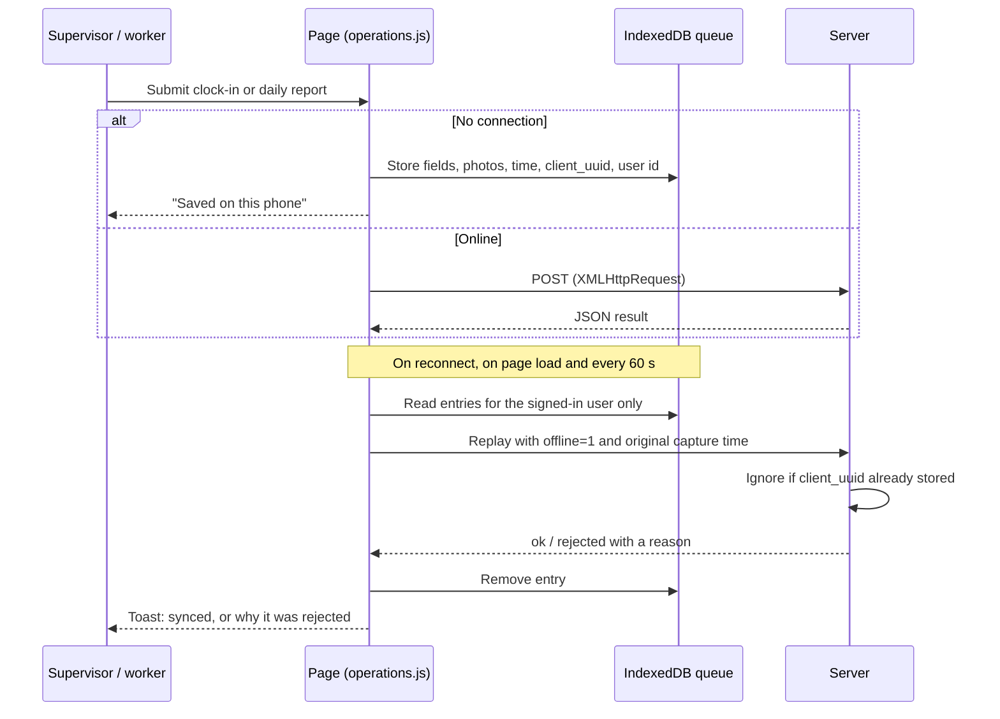
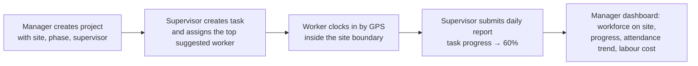

# System diagrams

These diagrams are written in [Mermaid](https://mermaid.js.org/) and render directly on GitHub and in most Markdown viewers (VS Code: install a Mermaid preview extension). To export images for a report, paste a diagram into the [Mermaid Live Editor](https://mermaid.live) and download it as PNG or SVG.

## 1. System architecture

BuildLink is a single server-rendered Django application. Browsers talk to it over HTTPS; phones on site also use a service worker and a local IndexedDB queue so attendance and reports keep working without signal.

## 2. Use cases

## 3. Entity-relationship diagram

Primary keys are `id` (auto-increment) on every table. `User.role` holds the role; roles are a fixed set of choices rather than a separate table, because each role's permissions are defined in code (`coordination/access.py`), not configured at runtime.

Tables carried over unchanged from release 1 (`Service`, `ClientProfile`, `ServiceRequest`, `Rating`, `Message`, `Notification`, `Complaint`) keep the columns described in `TECHNICAL_DESIGN.md`.

## 4. Activity: worker clocks in (GPS or QR)

## 5. Activity: payroll and mobile money payment

## 6. Activity: material or equipment request

## 7. Activity: offline sync

## 8. Demo flow

